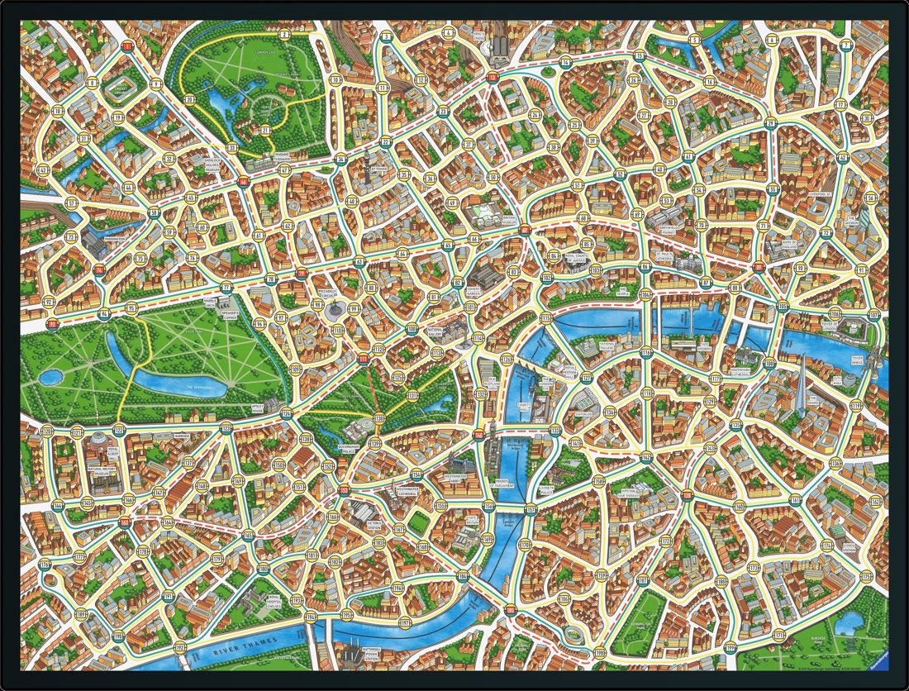

# Scotland Yard: Game Model (Java)

An immutable game engine for the board game Scotland Yard. It implements the full rule set behind a provided JavaFX interface: legal move generation, turn order, the ticket economy, Mr X's hidden travel log, and every win condition. Written in Java with an emphasis on immutability and clean object oriented design.



## The game

Scotland Yard is a hidden movement chase. A team of detectives hunts a single hidden player, Mr X, across a graph of London stations. Everyone moves by spending tickets for taxi, bus, or underground. Mr X stays invisible except on a few reveal rounds, can slip a secret ticket to hide the transport used, and can play a double move to jump twice in one turn. The detectives win by landing on Mr X, Mr X wins by surviving the full travel log.

I implemented the model, which is the rules engine that the interface drives. The JavaFX interface, the framework classes, and the test suite were provided by the course.

## What I built

Two classes carry the work: `MyGameStateFactory` and `MyModelFactory` in `src/main/java/uk/ac/bris/cs/scotlandyard/model/`.

- **Immutable state.** Each `GameState` is final and every `advance(move)` returns a brand new state rather than mutating the old one, so the game history is a chain of immutable snapshots.
- **Move generation.** Single moves read the board graph, exclude destinations blocked by detectives, and check the player holds the required transport ticket (or a secret ticket). Double moves chain two single moves, with the ticket accounting handled correctly for the case where both legs need the same ticket, and only when Mr X holds a double ticket and has enough log slots left.
- **Advancing a turn.** `advance` uses the visitor pattern over single and double moves. It updates the mover, hands a detective's spent ticket to Mr X, extends the travel log, and recomputes whose turn is next through a `remaining` set.
- **The travel log.** Entries are revealed or hidden depending on whether the current round is a reveal round, including both legs of a double move.
- **Win conditions.** Detective lands on Mr X, detectives run out of tickets, Mr X is cornered with no moves, every detective is stuck, or Mr X survives the full log.
- **Validation.** The constructor rejects a null or empty setup, a missing or duplicated Mr X, overlapping detective positions, and detectives holding tickets they should never have.
- **Observable model.** `MyModelFactory` wraps the state in a `Model` that registers observers and notifies them on each move and on game over.

Concepts on show: immutability, the visitor pattern, Guava immutable collections, `Optional`, and graph based board logic.

## Build and run

Uses the bundled Maven wrapper, so no local Maven install is needed. JDK 17 or newer; JavaFX is pulled in by Maven.

```bash
./mvnw test        # run the model test suite
./mvnw compile     # compile
```

To launch the JavaFX interface, run `uk.ac.bris.cs.scotlandyard.Main`. Note the full board image is a course asset and is not included here (see below), so the interface runs without its background map. The model and its tests do not need it.

## Tests

The model is checked by an extensive JUnit suite under `src/test/`: game state creation, available moves for Mr X and for detectives, move application, game over detection, full playouts, and observer behaviour.

```bash
./mvnw test
```

## Layout

```
src/main/java/.../model/MyGameStateFactory.java   the rules engine (my work)
src/main/java/.../model/MyModelFactory.java        the observable model (my work)
src/main/java/.../model/                           provided interfaces and types
src/main/java/.../ui/ , fxkit/                      provided JavaFX interface
src/test/java/.../model/                           provided test suite
src/main/resources/graph.txt                       the London board graph
```

## Notes

University of Bristol, Object Oriented Programming coursework, 2024, solo. The framework, the JavaFX interface, and the test suite were provided by the course; my own work is `MyGameStateFactory` and `MyModelFactory`. The full board image (Ravensburger artwork shipped with the course) is not redistributed here. If you are currently taking this unit, you are welcome to read it, but please do not submit any of it as your own.
